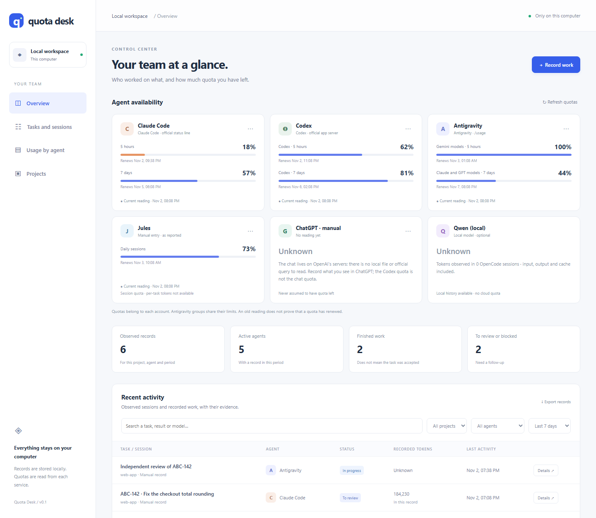

# Quota Desk

A local dashboard for your AI coding agents. It shows how much quota you have
left on Codex, Claude Code and Antigravity, the recent sessions of each agent
with their token counts, and a log of who worked on what, all read from files
and official commands on your own machine.



- **No dependencies, no accounts, no telemetry.** Node 22.13+ and a browser.
- **Read-only towards your agents.** It never starts a conversation, logs in or
  spends credits. From session logs it keeps usage and titles plus a short,
  redacted excerpt of the first request, never full prompts or transcripts.
- **Loopback by default.** `http://127.0.0.1:4318`, with an opt-in, read-only
  [LAN mode](#lan-mode-opt-in).

## Install

```bash
npm install --global quota-desk
quota-desk
```

Then open `http://127.0.0.1:4318`. Stop it with Ctrl+C.

From a checkout instead:

```bash
git clone https://github.com/isanchez-aguilar/quota-desk.git
cd quota-desk
npm start
```

On Windows, `Start-QuotaDesk.ps1` starts the server hidden in the background and
opens the browser (`-NoBrowser` to skip that); `Stop-QuotaDesk.ps1` stops it
after checking that the recorded PID really is this server.

```text
quota-desk [--port <n>]       Start the panel (default port 4318)
quota-desk record <file.json> Add a work record
quota-desk capture [agy]      Status-line command for Claude Code
quota-desk data               Print the data folder
quota-desk --version | --help
```

## What it reads

| Source | How | What is kept |
|---|---|---|
| Codex quota | `codex app-server`, method `account/rateLimits/read` only, with your existing login | 5-hour and 7-day windows, reset times, extra resets if reported |
| Antigravity quota | `agy -p /usage` in plan mode; the response must show zero turns and zero tokens | Each group's shared windows (they are not per-model credits) |
| Claude Code quota | The official status-line JSON, through `quota-desk capture` | 5-hour and 7-day `rate_limits`, if your plan reports them |
| Claude Code and Codex sessions | The 80 most recent JSONL logs in `~/.claude/projects` and `~/.codex/sessions` (files over 64 MiB are skipped) | Session id, title, a first-request excerpt (max 240 characters, credential patterns redacted, code blocks removed), model, branch, timestamp, token total |
| Qwen through OpenCode | `~/.local/share/opencode/opencode.db`, opened read-only | Token counts for a provider named `local` with a Qwen model; never message content |
| Relay runs | `.ai/runs/*` in the projects you add and their Git worktrees, as written by [Relayrace AI](https://github.com/isanchez-aguilar/relayrace-ai) | Task, hand-off summary, status, provider, model and tokens per turn |
| Jules and ChatGPT | Manual readings you type in | What you entered, marked as such |

Quotas are re-read when the page opens and every five minutes, at most once a
minute. Session tokens and account quotas are separate things: tokens are never
converted into credits or a bill. A finished session is not a finished task, and
an agent saying "done" never overrides the relay's own review status. Unknown
values stay unknown instead of being guessed.

### Claude Code status line

Claude Code passes its quota to a status-line command. Point it at Quota Desk in
`~/.claude/settings.json`:

```json
{ "statusLine": { "type": "command", "command": "quota-desk capture" } }
```

It prints a short quota line and saves the reading. If you already have a status
line, keep yours and call `quota-desk capture` from it with the same stdin.
Project settings can override user settings; restart Claude Code to load it.

### Work records

Use **Record work** in the panel, or let an agent hand in a JSON file:

```bash
quota-desk record work.json
```

```json
{
  "agent": "claude",
  "project": "my-app",
  "task": "ABC-123 · Fix the sign-up validation",
  "status": "review",
  "model": "the model actually used",
  "summary": "What changed",
  "evidence": "Checks run and their results",
  "next": "What is left and who should review it",
  "branch": "fix/abc-123",
  "tokens": null
}
```

Agents: `claude`, `codex`, `agy`, `jules`, `chatgpt`, `qwen`. Statuses:
`registered`, `running`, `review`, `done`, `blocked`. `done` means this piece of
work ended, not that the task was approved. Use `null` for unknown tokens.

## Data folder and `config.json`

Everything Quota Desk stores lives in one folder, chosen in this order:

1. `QUOTA_DESK_DATA`, if set;
2. a `data/` folder next to the code that already has a `config.json` (checkouts
   from before 0.1.0 keep working);
3. `~/.quota-desk` (on Windows, `%USERPROFILE%\.quota-desk`).

`quota-desk data` prints it. It holds `config.json`, quota readings, labels,
manual records, the LAN code and, with the Windows scripts, the server logs. Keep
it when you upgrade. Do not put keys in it.

```json
{
  "projects": [
    { "name": "my-app", "path": "/home/you/code/my-app" },
    { "name": "api", "path": "C:\\code\\api", "cwd": "services/api" }
  ],
  "nativeSessions": true,
  "codexExe": "codex",
  "agyExe": "agy",
  "lan": false
}
```

| Key | Meaning |
|---|---|
| `projects` | Folders whose relay runs are read. `path` must be an absolute local path (network shares are refused). `cwd` is optional and used by Relayrace. Add projects from the panel or edit the file. |
| `nativeSessions` | `false` stops reading Claude Code, Codex and OpenCode logs. |
| `codexExe`, `agyExe` | Executables for the quota queries. Defaults: the Windows install location under `%LOCALAPPDATA%` if present, else `codex` and `agy` on `PATH`. |
| `lan` | `true` turns on [LAN mode](#lan-mode-opt-in). |

Restart the server after editing the file by hand.

## Using it with Relayrace AI

[Relayrace AI](https://github.com/isanchez-aguilar/relayrace-ai) is a separate
tool that runs several coding agents as one relay team. It never starts or
bundles Quota Desk; the two share only this `config.json`:

- `relayrace init` appends `{ "name", "path" }` to `projects` (backing the file
  up once as `config.json.bak-relaykit` and never touching existing entries), and
  `sync` reads `path` and the optional `cwd` of each entry.
- Quota Desk then shows the relay's runs in `.ai/runs` for those repos.

Tell Relayrace where the file is with `"agentDesk"` in its config file or the
`RELAYKIT_AGENT_DESK` environment variable (the names come from this project's
working title, Agent Desk):

```json
{ "agentDesk": "~/.quota-desk/config.json" }
```

Restart Quota Desk after `init` to see the new project. The `projects` format is
a shared contract: a change to it needs a matching change in Relayrace.

## Opening it from another device

The panel has no password of its own: on this computer, your operating-system
account is the protection. To reach it from another device, prefer an SSH tunnel,
which keeps the server on loopback and encrypts the traffic:

```bash
ssh -N -L 4318:127.0.0.1:4318 you@<this computer>
```

Then open `http://127.0.0.1:4318` on the other device. Use port 4318 on both
ends: the server answers only to the `Host` `127.0.0.1:4318` or `localhost:4318`.
This needs an SSH server on the computer running Quota Desk (on Windows, the
optional OpenSSH Server feature).

### LAN mode (opt-in)

For a phone or tablet on your home network, set `"lan": true` in `config.json`
and restart. Then:

- The server listens on all interfaces and accepts only a `Host` that is a
  private IPv4 address (10.x, 172.16–31.x, 192.168.x) with port 4318. DNS names
  are refused, which blocks DNS rebinding.
- Every other device must enter an access code (`XXXX-XXXX`). It is generated
  once and stored in `lan-code` in the data folder; on Windows,
  `Start-QuotaDesk.ps1` prints it with the LAN address. The browser stays signed
  in for 30 days or until the server restarts. Five wrong codes per minute lock
  that address out for the rest of the minute.
- **Other devices are read-only.** They can view, export and refresh quotas, but
  not add records, notes, projects or manual quotas. Make changes on the computer
  itself.
- **It is plain HTTP.** The code and the session cookie travel unencrypted, so
  anyone who can watch the network can capture them. Use it only on a network you
  control, never on public or shared Wi-Fi. When in doubt, use the SSH tunnel.
- Allow inbound TCP 4318 on private networks only. On Windows:
  `New-NetFirewallRule -DisplayName "Quota Desk" -Direction Inbound -Protocol TCP -LocalPort 4318 -Profile Private -Action Allow`.

A signed-in device sees everything the panel shows: quotas, session titles and
first-request excerpts, models, branches, token counts, your notes, and your
project names **with their absolute paths**. See [SECURITY.md](SECURITY.md) for
the full threat model.

## Development

```bash
npm run check
node --test
```

CI runs the suite on Windows, macOS and Linux with Node 22 and 24, and installs
the packed tarball on all three. See [CONTRIBUTING.md](CONTRIBUTING.md).

Official references: [Codex app server](https://learn.chatgpt.com/docs/app-server),
[Claude Code status line](https://code.claude.com/docs/en/statusline),
[Antigravity headless mode](https://antigravity.google/docs/cli/headless/),
[Antigravity `/usage`](https://antigravity.google/docs/cli/commands/usage).

## License

[Apache-2.0](LICENSE). Copyright 2026 Isaac Sanchez Aguilar.
